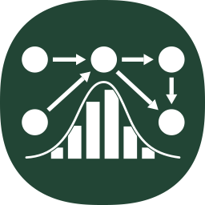

# FlatPPL resources

Cheatsheets and brand assets for FlatPPL.

## Cheatsheets

[Download the seven-sheet set](cheatsheets/flatppl-cheatsheets.pdf).

| Sheet | Outcome |
| --- | --- |
| [Distributions](cheatsheets/distributions.pdf) | Construct scalar, vector, and product distributions |
| [Beginner: simple models](cheatsheets/beginner.pdf) | Author a complete Bayesian or likelihood-only model |
| [Intermediate: hierarchical models](cheatsheets/intermediate.pdf) | Author grouped and multilevel models |
| [Advanced: measure composition](cheatsheets/advanced.pdf) | Build models from measures and kernels |
| [Particle counting and spectra](cheatsheets/particle-physics.pdf) | Combine channels, nuisances, templates, and event intensities |
| [Hadron amplitudes and Dalitz plots](cheatsheets/hadron-physics.pdf) | Construct a Bose-symmetric amplitude and phase-space measure |
| [Neutrino oscillations](cheatsheets/neutrino-physics.pdf) | Connect propagation functions to observed counts |

Each A4 landscape sheet pairs a complete program with four annotated passages and a figure drawn from the example.
All code blocks use FlatPPL syntax highlighting.
The [corpus map](cheatsheets/examples-map.md) links every curated example to the relevant level or domain.
[Sources and build instructions](cheatsheets/README.md) accompany the PDFs.

## Branding

[branding/](branding/) contains copies of the logo, editable art, wordmark, and favicon set.
The sheets use the [rounded squircle badge](branding/logo-rounded.svg).
Brand assets use [CC BY 4.0](branding/LICENSE.txt).

## Build

With Typst 0.15.1 or later:

```sh
make -C cheatsheets
```
